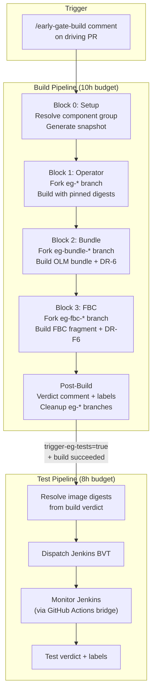
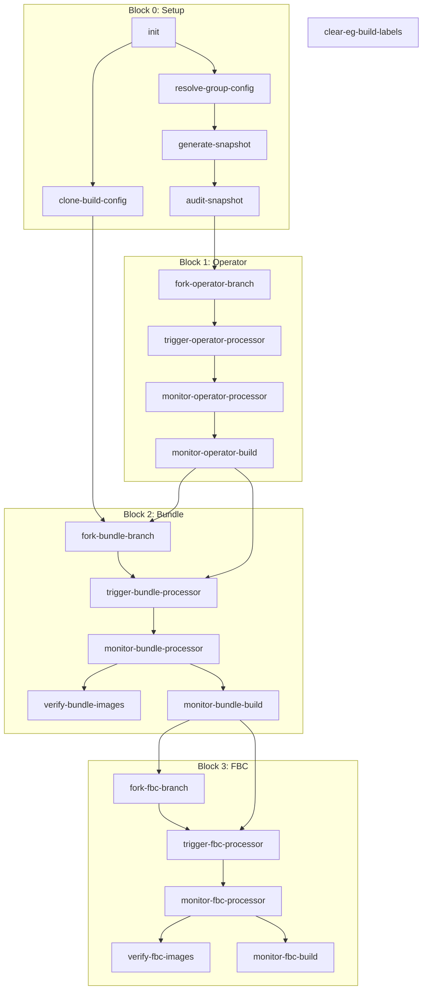
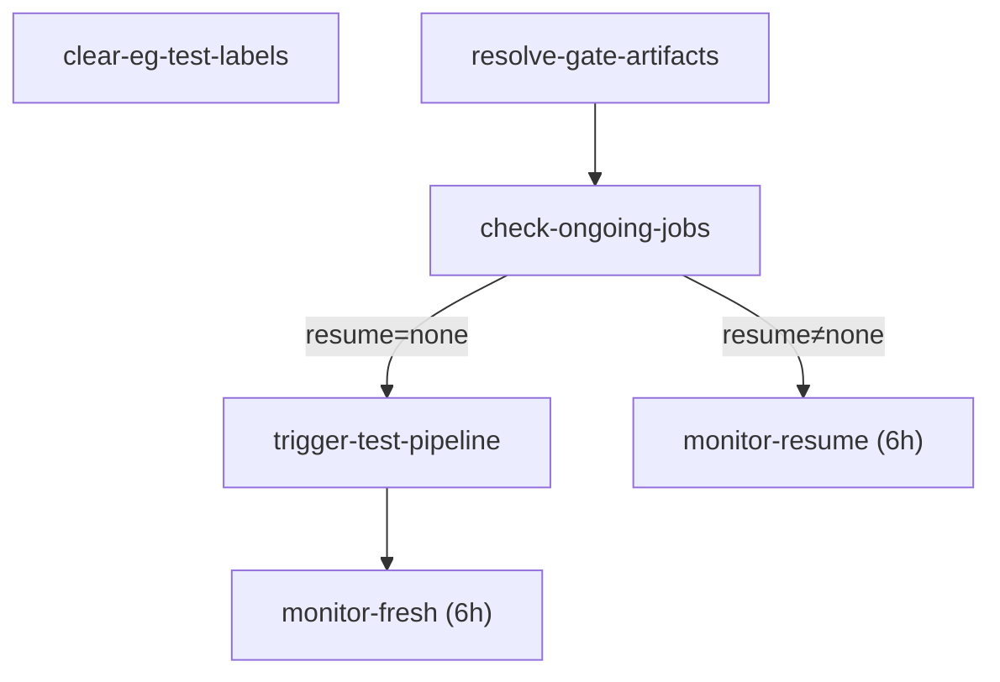
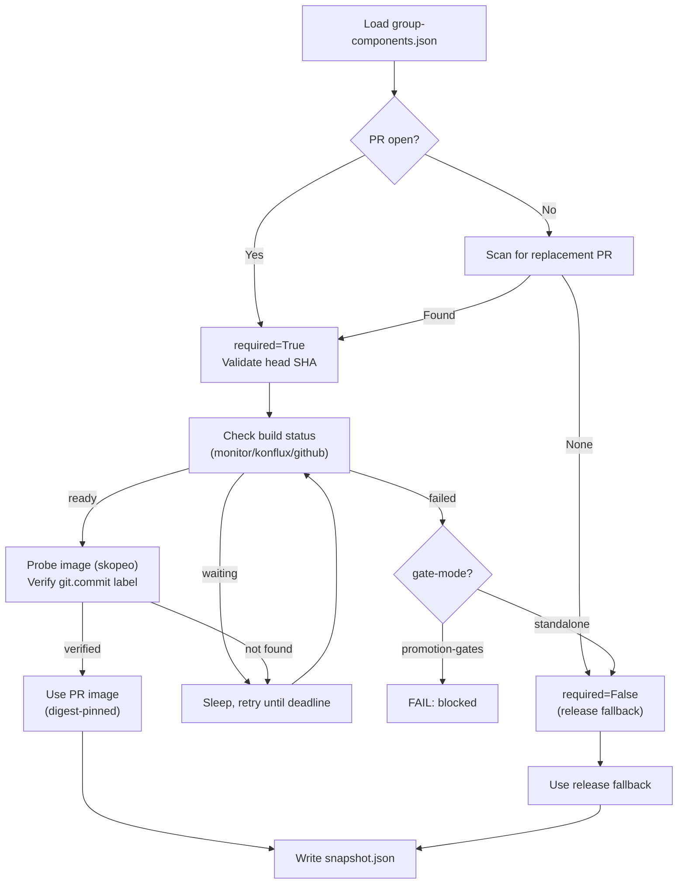
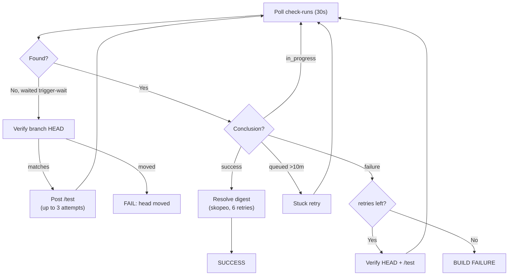

# Early Gate — Design and Implementation Guide

## 1. Overview

### 1.1 What is the Early Gate?

The Early Gate is a Tekton-based OLM composition validation system for RHOAI. It builds three sequential OLM artifacts — Operator, Bundle, and FBC Fragment — from a group of component images, then optionally runs BVT (Build Verification Tests) against the resulting catalog on a live cluster.

The Early Gate does not build components itself. It pushes commits to ephemeral branches and lets PaC trigger each repository's own `.tekton` build pipeline — the exact same pipeline used for release builds.

### 1.2 Two Operating Modes

| Mode | `gate-mode` | `build-status-source` | Behavior |
|---|---|---|---|
| **Promotion Gates** | `promotion-gates` | `monitor` | Strict blocking. Reads component group from a driving PR's `state.json`. Components without valid PR images are blocked (pipeline fails). Used by the Promotion Gates system to validate a batch before merge. |
| **Standalone** | `standalone` | `github` | Warning + fallback. Components without valid PR images fall back to the release baseline. Used for independent validation runs. |

In Promotion Gates mode, the pipeline is triggered by a `/early-gate-build` comment on a Leader PR in the `gated-artifacts-promoter` repository. The PR Monitor posts this comment after all component builds pass. Results are communicated back via labels (`early-gate-build-successful` / `early-gate-build-failed`) and HTML-marked verdict comments on the driving PR, which the Merge Orchestrator consumes.

In Standalone mode, the pipeline can be triggered manually on any PR with a child-PR list in its body.

### 1.3 Component Map

| File | Purpose |
|---|---|
| `early-gate-component-pipeline.yaml` | Build pipeline definition (~2200 lines, 28 tasks) |
| `early-gate-test-pipeline.yaml` | Test pipeline definition (~600 lines, 8 tasks) |
| `tasks/` | 18 reusable Tekton task definitions |
| `overlays/` | Workflow overlays for ephemeral branches |

PipelineRun triggers live in a separate repository (`gated-artifacts-promoter/.tekton/`):
- `early-gate-ci-build.yaml` — build PipelineRun
- `early-gate-ci-test.yaml` — test PipelineRun

### 1.4 End-to-End Flow



---

## 2. Triggering and Configuration

### 2.1 Build PipelineRun

**Source:** `gated-artifacts-promoter/.tekton/early-gate-ci-build.yaml`

| Property | Value |
|---|---|
| PaC `on-event` | `"[issue_comment]"` |
| PaC `on-comment` | `"(?m)^/early-gate(-build)?$"` |
| `cancel-in-progress` | `"true"` |
| `max-keep-runs` | `"3"` |
| Namespace | `rhoai-tenant` |
| Pipeline timeout | **10 hours** |
| Service account | `build-pipeline-early-gate-build` |

#### Workspaces

| Workspace | Binding | Purpose |
|---|---|---|
| `gate-data` | PVC (1Gi RWO) | Shared storage between task pods |
| `github-credentials` | Secret `eg-github-token` | GitHub API access (needs `actions:write`) |
| `quay-credentials` | Secret `quay-promotion-gates` | Read-only Quay robot for `quay.io/rhoai` |
| `konflux-credentials` | Secret `eg-konflux-read-token` | Read-only Konflux/archive access |

#### Parameters (Promotion Gates configuration)

| Parameter | Value | Description |
|---|---|---|
| `leader-pr-repo` | `red-hat-data-services/gated-artifacts-promoter` | Driving PR repository |
| `leader-pr-number` | `{{pull_request_number}}` | PaC-supplied |
| `leader-pr-commit` | `{{revision}}` | PaC-supplied |
| `build-status-source` | `monitor` | Use cached build observations from `state.json` |
| `gate-mode` | `promotion-gates` | Strict: blocked images are fatal |
| `monitor-evidence-max-age-seconds` | `5400` (90 min) | Max age of cached observations |
| `trigger-eg-tests` | `"true"` | Auto-chain into test pipeline |

### 2.2 Test PipelineRun

**Source:** `gated-artifacts-promoter/.tekton/early-gate-ci-test.yaml`

| Property | Value |
|---|---|
| PaC `on-event` | `"[issue_comment]"` |
| PaC `on-comment` | `"(?m)^/early-gate-test(s)?"` |
| `cancel-in-progress` | Not set (smoke runs occupy clusters) |
| Pipeline timeout | **8 hours** / Tasks timeout: **7 hours** |

Image references are deliberately NOT passed — `resolve-gate-artifacts` recovers them from the build verdict comment, decoupling the test trigger from build output.

### 2.3 Mode Determination

The `gate-mode` and `build-status-source` parameters determine behavior:

| `gate-mode` | `build-status-source` | Missing PR image | Build check source |
|---|---|---|---|
| `promotion-gates` | `monitor` | Fatal error (pipeline fails) | Reads `state.json` from driving PR HEAD |
| `standalone` | `github` | Warning + release fallback | Evaluates GitHub check-runs directly |
| `standalone` | `konflux` | Warning + release fallback | Queries Konflux API directly |

### 2.4 Timeout Budget

| Block | Task | Budget |
|---|---|---|
| 1 | Operator processor | 30 min |
| 1 | Operator build | 270 min |
| 2 | Bundle build | 90 min |
| 3 | FBC build | 150 min |
| **Total tasks** | | **~562 min (9h22m)** |
| **Build pipeline** | | **10h (38 min slack)** |
| **Test monitor** | | **6h** |
| **Test pipeline** | | **8h (tasks 7h)** |

---

## 3. Early Gate Build Pipeline

**Source:** `early-gate/early-gate-component-pipeline.yaml` (~2242 lines)

### 3.1 Block 0: Setup and Group Resolution

#### `init`

Standard Tekton initialization from the Konflux task bundle. No dependencies.

#### `clear-eg-build-labels`

Runs in parallel with `init`. Removes stale `early-gate-build-successful` and `early-gate-build-failed` labels via GitHub API DELETE. 404 (not present) is normal.

#### `clone-build-config`

**runAfter:** `init`. Uses `clone-build-config-repo.yaml`.

Resolves the latest Y-stream release branch on RHOAI-Build-Config:
1. If `build-config-branch-override` set → use directly
2. Otherwise: `git ls-remote --heads` for `rhoai-*` branches, sort numerically (GA wins over EA within same line, highest EA wins)
3. Clone, derive version/suffix (e.g., `rhoai-3.6` → version=3.6, suffix=v3-6)

**Results:** `SOURCE_ARTIFACT`, `release-branch`, `release-sha`, `rhoai-version`, `operator-version`, `component-suffix`

#### `resolve-group-configuration`

**runAfter:** `init`. Uses `resolve-group-configuration.yaml` (~639 lines).

Reads the driving PR body to discover which component PRs are in the group, then maps repositories to Konflux components.

**Flow:**
1. Fetch `component_repo_map.json` from `konflux-central@main`
2. Apply version suffix: append `-v${major}-${minor}` to all component names
3. Fetch driving PR body from GitHub API
4. **Fork source decision:** If operator repo referenced → fork from `main`; else → `stable`
5. Search for `## Early Gate` or `### Child PRs` section heading
6. Extract PR URLs, validate orgs, look up components, fetch head SHAs
7. Write `group-components.json` to `gate-data` workspace

**Results:** `has-group-config`, `source-branch`, `operator-pr-included`, `operator-source-sha`, `component-count`

#### `generate-snapshot`

**runAfter:** `resolve-group-configuration`. Uses `generate-snapshot-for-group-testing.yaml` (~1346 lines, 5 steps).

The core decision engine for snapshot generation. See [Section 5 — Shared Task Reference](#5-shared-task-reference) for full details.

**Step 1 (`resolve-pr-image-policy`):** Python script determining whether each component requires a PR image or can use release fallback. In `promotion-gates` mode, reads cached build observations from `state.json`. In `standalone` mode, evaluates GitHub check-runs.

**Step 2 (`generate-snapshot`):** Bash script probing images via `skopeo inspect`, verifying `git.commit` labels match expected SHAs, building `snapshot.json` with digest-pinned entries.

**Step 3 (`verify-pr-image-policy`):** Re-runs the policy check with `VERIFY_ONLY=true` to catch PR state changes during image selection.

**Step 4 (`describe-fallback-builds`):** Enrichment-only diagnostics. Skipped for `monitor`/`konflux` sources.

**Step 5 (`create-trusted-artifact`):** Publishes snapshot as OCI trusted artifact.

**Results:** `SNAPSHOT_ARTIFACT`, `omitted-component-count`

#### `audit-snapshot`

**runAfter:** `generate-snapshot`. Inline task. Logs snapshot and verifies operator component is present.

### 3.2 Block 1: Operator Build

#### `fork-operator-branch`

**runAfter:** `audit-snapshot`. Inline task.

Creates ephemeral branch `eg-<pr-number>-<pipelineRun.uid>` from `source-branch` HEAD via GitHub REST API. Force-resets if branch exists (idempotent re-runs). Validates `expected-source-sha` hasn't moved.

**Safety:** Only `eg-*` branch names accepted.

**Results:** `branch-name`, `branch-sha`

#### `trigger-operator-processor-on-ephemeral-branch`

**runAfter:** `fork-operator-branch`. Inline task, 3 steps:

1. **`use-trusted-artifact`:** Restores snapshot from OCI.
2. **`pin-output-image`:** Clones branch, edits `.tekton` file (Python/YAML): sets `output-image`, `rhoai-version`, `pipelineRef` revision. Stages `eg-snapshot.json` for operator-processor operand pinning. Optionally overlays EG-compatible workflow. Commits with `chore(early-gate):` subject (deliberately not `early-gate:` to avoid triggering a build prematurely). **Safety:** refuses non-`eg-*` branches.
3. **`dispatch`:** Records `previous-run-id`. Posts `workflow_dispatch` to `operator-processor.yaml` with inputs: `eg-mode`, `eg-branch`, `leader-pr-number`, `rhoai-version`.

#### `monitor-operator-processor`

**runAfter:** `trigger-operator-processor`. Inline task.

Polls GitHub Actions runs every 30s. Finds new run (ID > `previous-run-id`). Waits for `conclusion` (timeout: `processor-timeout-minutes`, default 30 min). On success: reads branch HEAD SHA.

**Results:** `processor-commit`, `branch-url`, `commit-url`

#### `monitor-operator-build`

**runAfter:** `monitor-operator-processor`. Uses `monitor-pac-build.yaml`.

Watches for PaC-triggered build on the ephemeral branch commit. See [monitor-pac-build reference](#monitor-pac-build) for recovery flow.

**Results:** `build-status`, `image-ref`, `image-digest`, `image-ref-by-digest`, `build-url`

### 3.3 Block 2: Bundle Build + DR-6

#### `fork-bundle-branch`

**runAfter:** `clone-build-config`, `monitor-operator-build`. Uses `create-ephemeral-branch.yaml`.

Creates `eg-bundle-<pr>-<uid>` on RHOAI-Build-Config from the resolved release branch.

#### `trigger-bundle-processor-on-ephemeral-branch`

**runAfter:** `fork-bundle-branch`, `monitor-operator-build`. Inline task, 2 steps:

1. **`prepare-branch`:** Clones branch, pins operator digest in `bundle-patch.yaml` (`ODH_OPERATOR` relatedImages entry), pins EG push pipeline in `.tekton/`, optionally overlays EG-compatible bundle processor. Commits with `early-gate:` subject + push.
2. **`dispatch`:** Dispatches `process-operator-bundle.yaml` with `operator-image-ref` input.

#### `monitor-bundle-processor`

Uses `monitor-processor-workflow.yaml`. Polls GitHub Actions, waits for completion, reads committed tree as trusted artifact.

**Results:** `processor-commit`, `branch-url`, `commit-url`, `SOURCE_ARTIFACT`

#### `verify-bundle-images` (DR-6)

**runAfter:** `monitor-bundle-processor`. Uses `verify-bundle-images.yaml`.

Asserts the processed bundle references EG images, not release ones:
1. All image refs pinned by digest, no release tags
2. Release tag detection: `FORBIDDEN_TAG_RE` matches `rhoai-X.Y*`, `odh-stable`, `odh-pr*`, `latest`, `stable`, `*-nightly`
3. Operator image is exactly Block 1's (digest comparison)
4. Gated components from snapshot appear at gated digests (matches by repo basename, survives registry rewrites)

`STRICT_MODE` (default: `false`) makes missing components a failure vs. report-only.

**Results:** `verified`, `eg-image-count`, `release-image-count`

#### `monitor-bundle-build`

Uses `monitor-pac-build.yaml` with `bundle-build-timeout-minutes` (default 90 min).

### 3.4 Block 3: FBC Build + DR-F6

#### `fork-fbc-branch`

**runAfter:** `monitor-bundle-build`. Creates `eg-fbc-<pr>-<uid>` on RHOAI-Build-Config.

#### `trigger-fbc-processor-on-ephemeral-branch`

Inline task, 2 steps:
1. **`prepare-branch`:** Pins bundle digest in `catalog-patch.yaml` (`patch.olm.bundle[0]`), pins EG push pipeline, optionally overlays.
2. **`dispatch`:** Dispatches `process-fbc-fragment.yaml`.

#### `verify-fbc-images` (DR-F6)

Uses `verify-fbc-images.yaml`. 5 checks:
1. EG bundle exists in catalog (by name or digest match)
2. Bundle image is exactly Block 2's (digest comparison, tolerates registry/repo rewrites)
3. All relatedImages pinned by digest, no release tags
4. Block 1's operator digest present in relatedImages
5. An `olm.channel` references the bundle name (unreachable bundle = `purge_unused_olm_bundles` would drop it)

**Results:** `verified`, `related-image-count`, `legacy-bundle-count`, `bundle-name`, `catalog-path`

#### `monitor-fbc-build`

Uses `monitor-pac-build.yaml` with `fbc-build-timeout-minutes` (default 150 min).

### 3.5 Post-Build and Finally

#### Verdict Comments

| Task | Condition | Action |
|---|---|---|
| `comment-on-leader-pr` | `tasks.status == Succeeded` | Posts success verdict (see [HTML markers](#64-html-marker-conventions)) |
| `comment-on-leader-pr-failure` | `tasks.status != Succeeded` | Posts failure verdict with pipeline diagnostics |

Both use `post-build-complete-comment.yaml`. The failure path includes K8s API TaskRun queries, task status tables, and last 50 lines of pod logs for failed steps.

#### Labels

| Task | Condition | Label | Color |
|---|---|---|---|
| `label-build-successful` | Succeeded | `early-gate-build-successful` | Green `#0E8A16` |
| `label-build-failed` | Not Succeeded | `early-gate-build-failed` | Red `#D73A4A` |

#### Ephemeral Branch Cleanup

Three cleanup tasks run in `finally` (always execute): operator, bundle, FBC. Each tags the branch before deletion (preserves build source as git tag for audit). `defer-*-branch-cleanup` parameters allow keeping branches for debugging.

**Safety:** Only `eg-*` branches accepted. 404 (already cleaned) handled gracefully.

#### Test Pipeline Chaining

`trigger-early-gate-test`: Posts `/early-gate-tests` comment on the driving PR. Only runs when `trigger-eg-tests=true` AND `tasks.status == Succeeded`. Never chains into test of a failed build.

### 3.6 Pipeline Results

22+ results exposing per-block artifacts:

| Category | Results |
|---|---|
| **Operator** | `EG_BRANCH`, `OPERATOR_COMMIT`, `OPERATOR_IMAGE_URL`, `OPERATOR_IMAGE_DIGEST`, `OPERATOR_IMAGE_REF_BY_DIGEST`, `BUILD_STATUS` |
| **Snapshot** | `OMITTED_COMPONENT_COUNT`, `SNAPSHOT_ARTIFACT` |
| **Bundle** | `EG_BUNDLE_BRANCH`, `BUNDLE_RELEASE_BRANCH`, `BUNDLE_COMMIT`, `BUNDLE_IMAGE_*`, `BUNDLE_BUILD_STATUS`, `BUNDLE_BUILD_URL`, `BUNDLE_VERIFIED` |
| **FBC** | `EG_FBC_BRANCH`, `FBC_COMMIT`, `FBC_IMAGE_*`, `FBC_BUILD_STATUS`, `FBC_BUILD_URL`, `FBC_VERIFIED`, `FBC_CATALOG_PATH`, `FBC_BUNDLE_NAME` |

---

## 4. Early Gate Test Pipeline

**Source:** `early-gate/early-gate-test-pipeline.yaml` (~604 lines)

### 4.1 Setup

#### `clear-eg-test-labels`

No dependencies (parallel). Removes stale `early-gate-tests-successful` and `early-gate-tests-failed` labels.

#### `resolve-gate-artifacts`

No dependencies. Uses `resolve-gate-artifacts.yaml`.

Recovers operator/bundle/FBC digests from the build verdict comment:
1. If all 3 image refs supplied as parameters → use directly (`source="params"`)
2. Otherwise: scan driving PR comments for latest `<!-- early-gate-build-complete` HTML marker
3. Extract `KEY=VALUE` pairs: `OPERATOR_IMAGE_REF_BY_DIGEST`, `BUNDLE_IMAGE_REF_BY_DIGEST`, `FBC_IMAGE_REF_BY_DIGEST`, `GAP_PR_COMMIT`
4. Validate FBC is not empty (required — nothing to test without a catalog)
5. Validate all refs are sha256 digest-pinned

**Results:** `operator-image-ref`, `bundle-image-ref`, `fbc-image-ref`, `leader-commit`, `source`

### 4.2 Test Dispatch

#### `check-ongoing-jobs`

**runAfter:** `resolve-gate-artifacts`. Uses `check-ongoing-jobs.yaml` (~20KB).

Makes the test pipeline idempotent — scans driving PR comments for a Jenkins job from a previous run that never finished.

**Flow:**
1. If `force-fresh=true` → emit `resume-from=none`, exit
2. Scan comments newest-first (up to 5 pages of 100)
3. Group by `correlation-id` from HTML markers
4. For each candidate without a completion marker: check job status via GitHub Actions dispatch
5. If terminal → abandon. If still running → resume it.

**Results:** `resume-from` (`"none"` or job URL), `queue-url`, `job-url`, `correlation-id`

#### `trigger-test-pipeline`

**runAfter:** `check-ongoing-jobs`. **When:** `resume-from == "none"`. Uses `trigger-test-pipeline.yaml`.

**DR-6 guard:** Validates no image carries a release-shaped tag before dispatch. FBC image is required.

**Dispatch:** Posts GitHub Actions `workflow_dispatch` to `promotion-gates-test-trigger.yaml`. Waits for run completion (up to 15 min). Scrapes logs for Jenkins queue URL. Posts queue-url comment on driving PR.

**Results:** `queue-url`, `correlation-id` (`eg-${pr-number}-$(date +%s)`)

### 4.3 Test Monitoring

#### `monitor-fresh` / `monitor-resume`

**Timeout:** 6 hours each. Uses `monitor-jenkins-job.yaml` (~867 lines).

Mutually exclusive paths via `when` clause on `resume-from`:
- **Fresh:** Gets `queue-url` from `trigger-test-pipeline`, no `job-url`
- **Resumed:** Gets `job-url` from `check-ongoing-jobs`, skips queue resolution

Jenkins is NEVER contacted directly — every call goes through a monitor workflow on GitHub Actions (Jenkins is on internal network).

**Three phases:**

| Phase | Poll Interval | Max Attempts | Purpose |
|---|---|---|---|
| A: Queue→Job URL | `queue-url-poll-interval` (120s) | 20 | Resolve Jenkins queue to job URL |
| B: Poll to terminal | `job-status-poll-interval` (300s) | 120 | Wait for job completion |
| C: Structured summary | `summary-poll-interval` (60s) | — | Fetch test results from `odh-build-metadata` |

**Phase C summary:** Path derived as `rhoai-${version}/rhoai-fbc-fragment-sha256-${digest}/promotion-gate-test-summary.yaml`. Three categories: `cluster-health`, `operator-health`, `components`. Test counts outrank Jenkins status (avoids false negatives from teardown ABORTED).

**Verdict comment:** HTML marker `<!-- early-gate-job-complete ... GAP_PR_COMMIT=... -->` with per-category test summary table.

### 4.4 Finally Tasks

| Task | Condition | Label |
|---|---|---|
| `label-tests-successful` | Succeeded | `early-gate-tests-successful` (green) |
| `label-tests-failed` | Not Succeeded | `early-gate-tests-failed` (red) |

---

## 5. Shared Task Reference

### 5.1 Build Monitoring Tasks

#### `monitor-pac-build`

Watches for PaC-triggered builds on ephemeral branches. Used by all three blocks.

| Parameter | Default | Description |
|---|---|---|
| `repo` | (required) | `org/repo` with the pushed commit |
| `commit` | (required) | SHA to watch |
| `check-name` | (required) | PaC check-run name substring |
| `branch-name` | `""` | For `/test` recovery |
| `trigger-wait-seconds` | `120` | Wait before first recovery |
| `max-trigger-attempts` | `3` | Max `/test` comment attempts |
| `retry-on-failure-count` | `2` | Build failure retries |
| `retry-stuck-queued-count` | `1` | Stuck-queued retries |
| `stuck-queued-minutes` | `10` | Minutes before queued retry |
| `output-image` | (required) | Image repo without tag |
| `image-tag` | `""` | Build tag |
| `timeout-minutes` | `60` | Total budget |

**Recovery flow:** Polls check-runs every 30s. If no check appears after `trigger-wait-seconds`: verifies branch HEAD = monitored commit, posts `/test <check-name> branch:<branch>` (up to 3 attempts). Stuck-queued runs (>10 min) and failed runs also retried. After retry, same check-run ID suppressed until PaC replaces it. On success: resolves digest via `skopeo` (6 retries @ 10s).

**Results:** `build-status`, `image-ref`, `image-digest`, `image-ref-by-digest`, `build-url`, `check-run-url`

#### `monitor-processor-workflow`

Polls GitHub Actions runs every 30s. Finds new run (ID ≠ `previous-run-id`). Waits for success conclusion. Reads branch HEAD SHA and clones as trusted artifact.

**Results:** `processor-commit`, `branch-url`, `commit-url`, `SOURCE_ARTIFACT`

### 5.2 Branch Management Tasks

#### `create-ephemeral-branch`

Creates branch from known commit via GitHub refs API. Only `eg-*` names accepted. 422 → force-reset (idempotent).

#### `cleanup-ephemeral-branch`

Tags branch before deleting (audit trail). Respects `defer-cleanup`. Only `eg-*` accepted. 404 handled gracefully.

### 5.3 Label and Comment Tasks

#### `set-eg-test-label`

Generic label task. Creates label repo-wide (422 = exists), then adds to PR.

#### `clear-eg-build-labels` / `clear-eg-test-labels`

DELETE each label from PR; 404 = not present.

#### `trigger-early-gate-test`

Posts `/early-gate-tests` comment to chain build→test.

#### `post-build-complete-comment`

Posts verdict comment with K8s API diagnostics on failure (TaskRun queries, pod log excerpts).

### 5.4 Verification Tasks

#### `verify-bundle-images` (DR-6)

4 checks: digest pinning, no release tags, operator digest match, gated component presence.

#### `verify-fbc-images` (DR-F6)

5 checks: bundle in catalog, bundle digest match, digest pinning, operator digest presence, channel reachability.

### 5.5 Test Pipeline Tasks

#### `resolve-gate-artifacts`

Recovers digests from build verdict comment or from parameters.

#### `check-ongoing-jobs`

Idempotency check — scans for unfinished Jenkins jobs to resume.

#### `trigger-test-pipeline`

DR-6 guard + GitHub Actions dispatch + queue URL extraction.

#### `monitor-jenkins-job`

Three-phase Jenkins monitoring through GitHub Actions bridge.

---

## 6. Data Structures and Interfaces

### 6.1 Snapshot JSON

Generated by `generate-snapshot`, consumed by operator-processor:

```json
{
  "components": [
    {
      "name": "odh-dashboard-v3-7",
      "containerImage": "quay.io/rhoai/odh-dashboard-rhel9@sha256:abc...",
      "source": {
        "git": {
          "url": "https://github.com/red-hat-data-services/odh-dashboard",
          "revision": "abc123..."
        }
      }
    }
  ]
}
```

### 6.2 group-components.json

Generated by `resolve-group-configuration`, consumed by `generate-snapshot`:

```json
{
  "odh-dashboard-v3-7": {
    "quay_path": "rhoai/odh-dashboard-rhel9",
    "pr": "42",
    "sha": "abc123...",
    "pr_url": "https://github.com/.../pull/42",
    "repo": "odh-dashboard"
  }
}
```

### 6.3 component_repo_map.json

Fetched at runtime from `konflux-central@main`. Maps repo names → component names → Quay paths. Component names stored without release suffix (`-vX-Y` appended at runtime).

### 6.4 HTML Marker Conventions

| Marker | Producer | Consumer |
|---|---|---|
| `<!-- early-gate-build-complete ... -->` | `post-build-complete-comment` | Merge Orchestrator, `resolve-gate-artifacts` |
| `<!-- early-gate-job-complete ... -->` | `monitor-jenkins-job` | Merge Orchestrator |
| `<!-- early-gate-queue-url ... -->` | `trigger-test-pipeline` | `check-ongoing-jobs` |
| `<!-- early-gate-job-url ... -->` | `monitor-jenkins-job` | `check-ongoing-jobs` |

Markers carry key-value pairs: `queue_url=...`, `job_url=...`, `correlation_id=...`, `GAP_PR_COMMIT=...`, `OPERATOR_IMAGE_REF_BY_DIGEST=...`, etc.

### 6.5 Label Conventions

| Label | Color | Applied By |
|---|---|---|
| `early-gate-build-successful` | Green `#0E8A16` | Build finally block |
| `early-gate-build-failed` | Red `#D73A4A` | Build finally block |
| `early-gate-tests-successful` | Green | Test finally block |
| `early-gate-tests-failed` | Red | Test finally block |

Stale labels cleared at the start of each pipeline run.

### 6.6 Ephemeral Branch Naming

| Pattern | Repository | Purpose |
|---|---|---|
| `eg-<pr>-<pipelineRun.uid>` | `rhods-operator` | Operator build |
| `eg-bundle-<pr>-<uid>` | `RHOAI-Build-Config` | Bundle build |
| `eg-fbc-<pr>-<uid>` | `RHOAI-Build-Config` | FBC build |

UUID prevents collisions between concurrent runs. Branches tagged before deletion. Four safety rails refuse non-`eg-*` branches:
1. `create-ephemeral-branch` task
2. `operator-processor.yaml` EG mode guard
3. `bundle-processor` / `fbc-processor` guards
4. Push tasks reject commit messages not starting with `early-gate:` or `chore(early-gate):`

---

## 7. Configuration Reference

### 7.1 Build Pipeline Parameters

| Parameter | Default | Description |
|---|---|---|
| `leader-pr-repo` | (required) | Driving PR repository |
| `leader-pr-number` | (required) | PR number |
| `leader-pr-commit` | `""` | PaC-supplied |
| `gate-mode` | `standalone` | `standalone` or `promotion-gates` |
| `build-status-source` | `monitor` | `monitor`, `konflux`, or `github` |
| `monitor-evidence-max-age-seconds` | `5400` | Max cached observation age |
| `pr-readiness-timeout-seconds` | `120` | Per-phase build check wait |
| `operator-repo` | `red-hat-data-services/rhods-operator` | Operator repository |
| `operator-output-image` | `quay.io/rhoai/odh-rhel9-operator` | Operator image base |
| `operator-source-branch` | `main` | Fork source (operator PR present) |
| `fallback-source-branch` | `stable` | Fork source (no operator PR) |
| `rhoai-version` | `""` | Auto-discovers if empty |
| `fallback-tag` | `""` | Release tag for fallback images |
| `allowed-child-orgs` | `red-hat-data-services` | Allowed PR orgs |
| `image-expires-after` | `7d` | OCI artifact expiry |
| `build-check-name` | `rhods-operator-eg-on-push` | Operator check-run name |
| `build-config-repo` | `red-hat-data-services/RHOAI-Build-Config` | Bundle/FBC repo |
| `build-config-branch-override` | `""` | Pin release branch |
| `bundle-output-image` | `quay.io/rhoai/odh-operator-bundle` | Bundle image base |
| `bundle-verify-strict` | `false` | DR-6 strict mode |
| `fbc-output-image` | `quay.io/rhoai/rhoai-fbc-fragment` | FBC image base |
| `fbc-openshift-version` | `v4.19` | Catalog directory version |
| `trigger-eg-tests` | `false` | Auto-chain build→test |
| `eg-overlay-operator-processor` | `false` | Overlay operator-processor workflow |
| `eg-overlay-bundle-processor` | `false` | Overlay bundle processor |
| `eg-overlay-fbc-processor` | `false` | Overlay FBC processor |
| `processor-timeout-minutes` | `30` | Operator processor budget |
| `build-timeout-minutes` | `270` | Operator build budget |
| `bundle-build-timeout-minutes` | `90` | Bundle build budget |
| `fbc-build-timeout-minutes` | `150` | FBC build budget |
| `konflux-central-revision` | `main` | Task resolution revision |

### 7.2 Test Pipeline Parameters

| Parameter | Default | Description |
|---|---|---|
| `leader-pr-repo` | (required) | Driving PR repository |
| `leader-pr-number` | (required) | PR number |
| `OPERATOR/BUNDLE/FBC_IMAGE_REF_BY_DIGEST` | `""` | Resolved from verdict if empty |
| `rhoai-version` | `""` | Release under test |
| `force-fresh` | `false` | Skip resume scan |
| `github-workflow-repo` | `red-hat-data-services/rhods-devops-infra` | Jenkins workflow location |
| `queue-url-poll-interval` | `120` | Queue poll interval (s) |
| `job-status-poll-interval` | `300` | Job poll interval (s) |
| `summary-repo` | `opendatahub-io/odh-build-metadata` | Summary location |
| `summary-branch` | `promotion-gate` | Summary branch |
| `delete-intermediate-comments` | `true` | Cleanup polling comments |

### 7.3 Secrets

| Secret | Purpose |
|---|---|
| `eg-github-token` | GitHub API: branch ops, workflow dispatch, PR comments |
| `quay-promotion-gates` | Read-only Quay robot for `quay.io/rhoai` |
| `eg-konflux-read-token` | Read-only Konflux API + KubeArchive |
| `rhods-ci` | Jenkins URL for test pipeline |

### 7.4 Workflow Overlays

Located in `early-gate/overlays/`. Copied onto ephemeral branches when `eg-overlay-*=true`:

| Overlay | Target | Purpose |
|---|---|---|
| `operator-processor.yaml` | `rhods-operator` | EG-compatible operator-processor (adds snapshot pinning) |
| `process-operator-bundle.yaml` | `RHOAI-Build-Config` | EG-compatible bundle processor (adds `--use-existing-digests`) |
| `process-fbc-fragment.yaml` | `RHOAI-Build-Config` | EG-compatible FBC processor (skips `refresh-pcc`) |

---

## 8. Data Flow Diagrams

### 8.1 Build Pipeline Task DAG



### 8.2 Test Pipeline Task DAG



### 8.3 Snapshot Generation Decision Flow



### 8.4 Monitor-PAC-Build Recovery Flow


