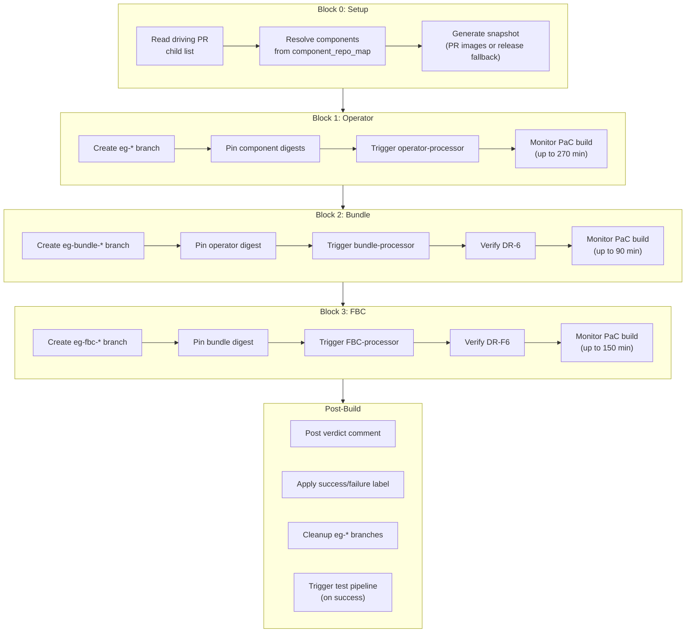
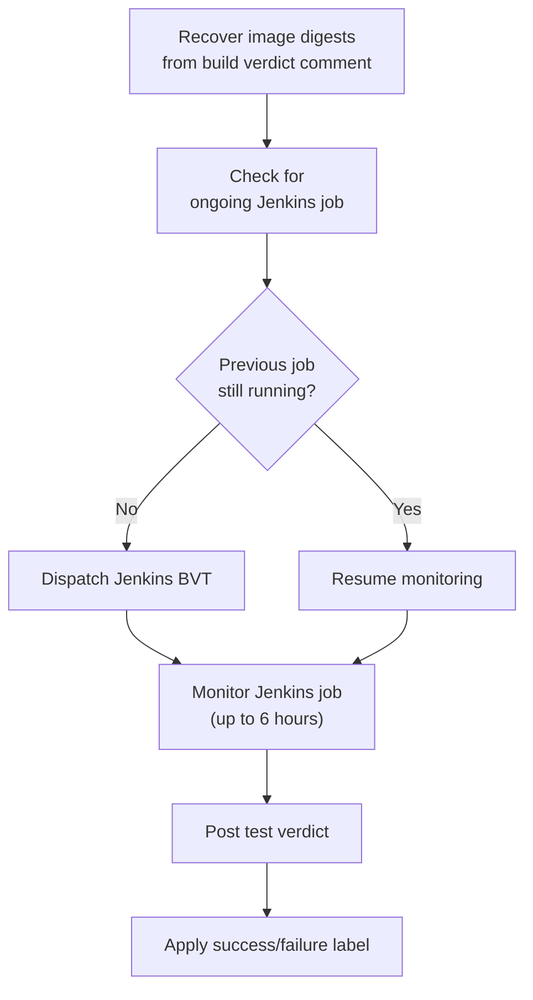

# Early Gate — User Guide

## 1. What is the Early Gate?

The Early Gate validates that the RHOAI Operator, Bundle, and FBC Fragment can be built together from a group of component images before those changes reach the release branch.

It operates in two modes:

| Mode | Triggered By | Behavior |
|---|---|---|
| **Promotion Gates** | `/early-gate-build` comment on a Leader PR (posted automatically by the PR Monitor after all component builds pass) | Strict: components without valid PR images block the pipeline. Results are reported via labels and verdict comments on the Leader PR. |
| **Standalone** | `/early-gate-build` comment on any PR with a child-PR list | Warning + fallback: components without valid PR images fall back to the release baseline. Used for independent validation. |

### What the Early Gate Produces

| Artifact | Description |
|---|---|
| **Operator image** | RHOAI operator container with all component digests pinned from the gated PRs |
| **Bundle image** | OLM bundle whose CSV references the operator by digest |
| **FBC Fragment image** | OLM catalog fragment carrying the bundle by digest |
| **Test results** | Per-component health check results from BVT on a live ROSA HCP cluster (when tests are enabled) |

### What the Early Gate Does NOT Do

- It does not build your component — it uses images already built by Konflux from your PRs
- It does not replace your component's own CI pipeline
- It does not modify release branches — all work happens on ephemeral `eg-*` branches that are deleted after the run

---

## 2. Early Gate Build Pipeline

The build pipeline runs four sequential blocks. Each block depends on the previous one — if any block fails, later blocks do not run.

### 2.1 Block 0: Setup

**What happens:** The pipeline reads the driving PR to discover which component PRs are in the group, then generates a snapshot of their container images.

**Key decisions:**
- **Fork source:** If the group includes the `rhods-operator` repository, the operator branch forks from `main`. Otherwise it forks from `stable`.
- **Image selection:** For each component, the pipeline checks whether the PR's build image is available. In Promotion Gates mode, components without valid images are blocked. In Standalone mode, they fall back to the release baseline.
- **Snapshot:** A `snapshot.json` lists every component with its verified image digest. This drives all subsequent blocks.

### 2.2 Block 1: Operator Build

1. Creates a temporary `eg-*` branch in the operator repository
2. Pins all component digests from the snapshot into the operator's configuration
3. Triggers the operator-processor GitHub Actions workflow
4. Monitors the PaC-triggered Konflux build until it completes

**Produces:** Operator container image with pinned component digests.

**Timeout:** Processor 30 min + Build 270 min.

### 2.3 Block 2: Bundle Build

1. Creates a temporary `eg-bundle-*` branch in RHOAI-Build-Config
2. Pins the operator digest from Block 1 into the bundle configuration
3. Triggers the bundle processor workflow
4. Runs **DR-6 verification** (confirms the bundle references EG images, not release ones)
5. Monitors the PaC-triggered Konflux build

**Produces:** OLM Bundle referencing the operator by digest.

**Timeout:** Up to 90 minutes.

### 2.4 Block 3: FBC Build

1. Creates a temporary `eg-fbc-*` branch in RHOAI-Build-Config
2. Pins the bundle digest from Block 2 into the FBC catalog configuration
3. Triggers the FBC processor workflow
4. Runs **DR-F6 verification** (confirms the catalog carries the EG bundle, not a release one)
5. Monitors the PaC-triggered Konflux build

**Produces:** OLM FBC Fragment carrying the bundle by digest.

**Timeout:** Up to 150 minutes.

### 2.5 Post-Build

After all blocks complete:
1. **Verdict comment** posted on the driving PR (see [Section 4](#4-understanding-results))
2. **Labels** applied: `early-gate-build-successful` or `early-gate-build-failed`
3. **Branch cleanup:** All `eg-*` branches tagged (audit trail) then deleted
4. **Test trigger:** If the build succeeded and `trigger-eg-tests=true`, posts `/early-gate-tests` to start the test pipeline

### 2.6 Timeout Budget

| Block | Maximum Duration |
|---|---|
| Operator processor | 30 min |
| Operator build | 270 min |
| Bundle build | 90 min |
| FBC build | 150 min |
| **Total** | **~9h 20min** |
| **Pipeline budget** | **10 hours** |

A typical successful run takes 45–90 minutes when builds are warm.

---

## 3. Early Gate Test Pipeline

### 3.1 What It Tests

The test pipeline triggers Jenkins Build Verification Tests (BVT) on a ROSA HCP cluster using the FBC catalog image produced by the build pipeline:

1. Provision a new ROSA HCP cluster
2. Deploy the RHOAI operator from the EG-built catalog
3. Run cluster health checks
4. Run RHOAI health checks (verify every DataScienceCluster component reaches Ready)
5. Run component-level health checks

### 3.2 How Tests Are Triggered

The build pipeline automatically posts `/early-gate-tests` on the driving PR when it succeeds (if `trigger-eg-tests=true`). The test pipeline recovers image digests from the build verdict comment — it does not need them passed explicitly.

### 3.3 Finding Test Results

| Location | What You'll Find |
|---|---|
| **Driving PR comments** | Test verdict comment with per-component results |
| **Jenkins dashboard** | Full build logs, test reports, and S3 artifacts (linked from verdict) |
| **odh-build-metadata** | Structured test summary in `promotion-gate-test-summary.yaml` |

### 3.4 Understanding Test Outcomes

The test verdict includes a summary table with three categories:

| Category | What It Checks |
|---|---|
| **Cluster Health** | Whether the OpenShift cluster itself is healthy |
| **Operator Health** | Whether the RHOAI operator deployed and all DSC components reached Ready |
| **Components** | Per-component health checks (AI Hub, AI Pipelines, KServe, etc.) |

Test counts outrank Jenkins job status — this avoids false negatives from teardown-phase failures.

### 3.5 Resuming vs Starting Fresh

If the test pipeline detects a Jenkins job from a previous run that is still active, it resumes monitoring that job instead of starting a new one. This prevents duplicate test runs.

### 3.6 Test Pipeline Timeout

8-hour total budget, with the Jenkins monitoring phase limited to 6 hours. A typical test run takes 2–4 hours.

---

## 4. Understanding Results

### 4.1 Labels

| Label | Color | Meaning |
|---|---|---|
| `early-gate-build-successful` | Green | Build pipeline completed: Operator, Bundle, and FBC all built successfully |
| `early-gate-build-failed` | Red | Build pipeline failed — check the verdict comment for which block failed |
| `early-gate-tests-successful` | Green | Jenkins BVT passed |
| `early-gate-tests-failed` | Red | Jenkins BVT failed — check the test verdict for details |

### 4.2 Build Verdict Comment

**Success verdict** (`✅ **Early Gate passed**`):

| Section | What It Shows |
|---|---|
| Status table | RHOAI version, PipelineRun link (opens Konflux UI) |
| Artifacts table | Each block with repository, tag, digest, and verification status |
| Component table | Whether each component used its **PR image** (gated code tested) or **release fallback** (baseline) |
| Fallback warnings | Details about components that fell back (collapsible) |

**Failure verdict** (`❌ **Early Gate failed**`):

| Section | What It Shows |
|---|---|
| Block status table | Which blocks succeeded, failed, or did not run |
| Blocked images | Components whose PR images could not be resolved (grouped by PR) |
| Pipeline diagnostics | Task names, statuses, durations, failed steps, exit codes, log excerpts |
| Build links | Links to any blocks that did complete |

### 4.3 Test Verdict Comment

Starts with `✅ **Early Gate Tests Passed**` or `❌ **Early Gate Tests Failed**`. Includes Jenkins job link, status icon, image refs, and per-category test summary table.

### 4.4 Konflux UI

The build verdict comment includes a PipelineRun link that opens the Konflux UI. Each block's build URL is listed in the artifacts table. You can also search the Konflux UI directly for PipelineRuns in `rhoai-tenant` with the `early-gate-build` component.

---

## 5. Frequently Asked Questions

### 5.1 Build Pipeline

**Q1. How is the Early Gate triggered?**

Post `/early-gate-build` as a comment on the driving PR. In Promotion Gates mode, the PR Monitor posts this automatically when all component builds pass. In Standalone mode, you post it manually.

**Q2. How long does an EG build take?**

A typical successful run takes 45–90 minutes. The pipeline has a 10-hour total budget for cold builds, retries, and slow infrastructure.

**Q3. What does "blocked images" mean in the verdict?**

The pipeline could not find a valid PR build image for one or more components. Common causes:
- The PR's Konflux build has not completed or has failed
- The PR was closed between setup and image probing
- The image's `git.commit` label does not match the expected SHA

**Q4. Why did the EG build fail when all component builds passed?**

The EG builds three additional artifacts (Operator, Bundle, FBC) not covered by component builds. Common EG-specific failures:
- Operator processor failed to pin component digests
- Bundle DR-6 violation (references a release-tagged image)
- FBC DR-F6 violation (catalog does not carry the EG bundle)
- Pipeline timeout
- PaC did not trigger (CEL expression mismatch)

**Q5. What is an ephemeral branch and why do I see eg-* branches?**

The EG creates temporary branches (`eg-*`, `eg-bundle-*`, `eg-fbc-*`) to trigger PaC builds. These are automatically deleted after the run (tagged first for audit). Orphaned branches from interrupted runs can be safely deleted.

**Q6. What is DR-6 verification?**

DR-6 checks that the bundle and FBC reference the EG's own images, not release baselines. It verifies:
- All image references are pinned by digest (no tags)
- No release-shaped tags appear (`rhoai-X.Y`, `odh-stable`, `latest`, etc.)
- The operator and bundle digests match the ones built in earlier blocks

**Q7. Can I manually trigger the Early Gate?**

Yes — post `/early-gate-build` on the driving PR. Manual triggering is useful for retrying after transient failures or for standalone validation runs.

**Q8. What happens if the EG build is cancelled mid-run?**

The build pipeline has `cancel-in-progress: true`, so a new `/early-gate-build` cancels any running build. The `finally` block still runs and cleans up ephemeral branches. Post `/early-gate-build` again to restart.

**Q9. How do I find the Konflux UI link for my EG build?**

The verdict comment includes a PipelineRun link. Each block's build URL is in the artifacts table. You can also search the Konflux UI for PipelineRuns in `rhoai-tenant` with component `early-gate-build`.

**Q10. What is the snapshot?**

The snapshot (`snapshot.json`) lists all component images the EG uses, each pinned by digest (`repo@sha256:...`) with source git URL and commit. The component table in the verdict shows which used PR images and which used fallback.

**Q11. What images does the EG produce?**

Three images, each pinned by digest:
1. Operator: `quay.io/rhoai/odh-rhel9-operator@sha256:...`
2. Bundle: `quay.io/rhoai/odh-operator-bundle@sha256:...`
3. FBC Fragment: `quay.io/rhoai/rhoai-fbc-fragment@sha256:...`

These expire after 7 days (not production artifacts).

**Q12. How does the EG handle components without active PRs?**

If a component's PR has been closed and no replacement exists, the component uses its release baseline image. In Promotion Gates mode, this is a fatal error (the pipeline fails). In Standalone mode, the component falls back with a warning.

### 5.2 Test Pipeline

**Q13. Why does the test pipeline say "resuming" instead of starting fresh?**

The pipeline detected a Jenkins job from a previous run that is still active and is resuming monitoring. This prevents duplicate test runs.

**Q14. How do I access Jenkins test results?**

The test verdict comment includes a Jenkins build link. From there: full console output, S3 artifacts (test logs, pod logs, BVT results), and Jira tickets for failures. For S3, log in via Red Hat IT AWS → `qe-rhods-general` → `rhoai-testops` or `rhoai-dev` role.

**Q15. What is the relationship between EG build and EG test?**

The build produces OLM artifacts. The test deploys them on a live cluster and runs smoke tests. They are separate pipelines with separate triggers, timeouts, and failure modes. The build triggers the test automatically on success.

### 5.3 General

**Q16. What are the two EG modes?**

**Promotion Gates:** Strict blocking. Missing PR images are fatal. Used automatically by the Promotion Gates system. **Standalone:** Warning + fallback to release images. Used for independent or manual validation.

**Q17. What credentials does EG use?**

| Secret | Purpose |
|---|---|
| `eg-github-token` | GitHub API: branch ops, workflow dispatch, PR comments |
| `quay-promotion-gates` | Read-only Quay robot for probing private images |
| `eg-konflux-read-token` | Read-only Konflux API access for build status |
| `rhods-ci` | Jenkins URL for test pipeline |

These are managed by the EG infrastructure team. Component teams do not need access.

**Q18. What does the EG NOT do?**

The EG does not build components, does not modify release branches, does not replace component CI, and in Phase 1 does not block sync PR merges (results are informational in Promotion Gates mode).

---

## 6. Troubleshooting

### 6.1 Build Failures

#### "Required collaborator PR images blocked"

The EG could not find a valid PR build image for a component with an active PR.

**Check:**
1. Does the PR have a successful Konflux build on its current head commit?
2. Is the image published with the `on-pr-<number>` tag?
3. Does the image's `git.commit` label match the PR head SHA?

#### "PR readiness deadline reached"

The EG waited for a component's build to become ready but timed out.

**Check:**
1. Is the component's Konflux build still running?
2. Was the PR force-pushed during the EG run? (SHA rotation causes deadline failure)

#### "DR-6 violation: bundle is carrying a non-gated build"

The bundle references a release-tagged image instead of the EG-built image.

**Check:** `update-group-snapshot` logs for "no matching entry" warnings. This is typically a `bundle-patch.yaml` issue on the release branch — escalate to the infrastructure team.

#### "PipelineRun validation failed"

The PipelineRun YAML has a syntax or parameter error. This is a pipeline infrastructure issue — escalate.

#### "Build cancelled by cancel-in-progress"

A new EG build was triggered while a previous one was running. The older run was cancelled. Wait for the new run or post `/early-gate-build` again.

#### "PaC did not trigger a build"

The EG pushed commits to an ephemeral branch but PaC did not start a build. The monitor makes up to 3 `/test` recovery attempts. If recovery fails, the CEL expression may not match the branch pattern.

#### Processor workflow failure

The operator-processor, bundle-processor, or FBC-processor GitHub Actions workflow failed. Check the workflow run on the target repository for error details.

#### FBC verification failure

The regenerated catalog does not carry the EG bundle, or carries release-tagged images. Check the `verify-fbc-images` task output for specific check failures.

### 6.2 Test Failures

#### Jenkins test not triggering

The GitHub Actions workflow dispatch failed or timed out. Check the workflow run on `rhods-devops-infra` for errors.

#### "No FBC image reference"

The test pipeline could not recover the FBC image digest from the build verdict comment. FBC is required — without a catalog image, there is nothing to test.

### 6.3 Reading Pipeline Diagnostics

The failure verdict includes a **Pipeline Diagnostics** section:

| Column | Meaning |
|---|---|
| **Task** | Tekton task name |
| **Status** | Succeeded / Failed / Skipped |
| **Duration** | Task runtime |
| **Failed Step** | Which step failed |
| **Exit Code** | Step exit code |

Below the table: last 50 lines of logs from each failed step. Start here when diagnosing failures.

### 6.4 When to Escalate

Escalate when:
- Repeated infrastructure errors (processor failures, PaC not triggering)
- DR-6 or DR-F6 violations (usually build-config issues)
- Jenkins cannot be reached or jobs hang
- Orphaned `eg-*` branches are not being cleaned up

Include: driving PR URL, PipelineRun name/link (from verdict), specific error or failed task, what you have checked.

---

## 7. Architecture Overview

### 7.1 Build Pipeline Flow

### 7.2 Test Pipeline Flow

### 7.3 Key Design Principles

1. **Same pipeline:** EG pushes to ephemeral branches and lets PaC trigger each repo's own `.tekton` pipeline — the exact same pipeline used for release builds
2. **Digest-only handoffs:** Every block passes images to the next by immutable digest (`repo@sha256:...`), never by mutable tags
3. **Ephemeral branches:** `eg-*` branches are created for the run and deleted afterward (tagged first for audit)
4. **Four safety rails:** Four independent enforcement points refuse non-`eg-*` branches
5. **Build-test separation:** Separate pipelines with separate triggers, timeouts, and failure modes
6. **Idempotent tests:** Test pipeline resumes unfinished Jenkins jobs instead of starting duplicates
7. **Two operating modes:** Strict (Promotion Gates) and flexible (Standalone) from the same pipeline

For implementation details, see the [Early Gate Design Doc](early-gate-design-doc.md).
